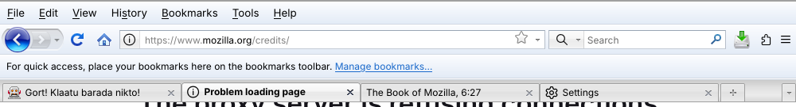
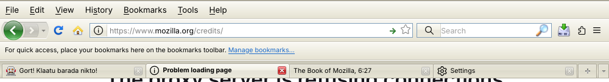

# Strata pour Firefox moderne

Thème `userChrome.css` qui redonne à Firefox moderne l'apparence du thème Windows de
**Firefox 3** (3.0 à 3.6), en deux variantes :

- **Vista / Seven** : icônes bleues, bouton « trou de serrure » bleu, couleurs Aero ;
- **XP** : icônes vertes, bouton « trou de serrure » vert, couleurs Luna, boutons de fermeture d'onglet carrés.

Les images sont les fichiers **originaux** du thème « winstripe » de Firefox 3.6
(variantes `*.png` pour XP et `*-aero.png` pour Vista/Seven), extraits des sources Mozilla.




*Captures faites sous Linux : sous Windows, les polices Segoe UI (Vista/Seven) et Tahoma (XP) sont utilisées.*

## Ce qui est reproduit

- Ordre des barres de Firefox 3 : menus, navigation, marque-pages, **onglets sous les barres**, juste au-dessus de la page ;
- bouton Précédent / Suivant en **trou de serrure** avec sa flèche d'historique ;
- icônes 24 px de Firefox 3 pour Actualiser, Arrêter, Accueil, Téléchargements, Historique,
  Marque-pages, Imprimer, Nouvel onglet, Nouvelle fenêtre, Couper, Copier, Coller, Plein écran
  (icônes 16 px dans les autres barres d'outils) ;
- barre d'adresse : bloc d'identité gris, bleu (site sécurisé) ou vert (certificat EV), étoile jaune, flèche « Aller » ;
- barre de recherche avec la loupe de Firefox 3 ;
- onglets carrés de Firefox 3 (fonds d'origine), titre en gras pour l'onglet actif, bouton de fermeture sur chaque onglet,
  boutons « + » et liste des onglets en forme d'onglet ;
- dossiers de la barre personnelle, menus de style Vista ou XP.

## Installation

Téléchargez l'archive `StrataFox-<version>.zip` de la dernière
[release](https://github.com/kawakode/StrataFox/releases/latest) et décompressez-la :
elle contient le dossier `chrome` et un fichier `INSTALLATION.txt` qui reprend ces étapes.

1. Ouvrez `about:config` et passez `toolkit.legacyUserProfileCustomizations.stylesheets` à **true**.
2. Ouvrez `about:support`, ligne **Dossier de profil**, cliquez sur **Ouvrir le dossier**.
3. Copiez le dossier `chrome` de ce paquet dans ce dossier de profil
   (s'il existe déjà un dossier `chrome`, fusionnez-le et ajoutez les lignes `@import` à votre `userChrome.css`).
4. Redémarrez Firefox.

### Choisir la variante

Dans `chrome/userChrome.css`, gardez une seule des deux lignes :

```css
@import url("strata/strata-aero.css");   /* Windows Vista / Seven */
/* @import url("strata/strata-xp.css"); */ /* Windows XP */
```

Pour XP, mettez la première en commentaire et enlevez le commentaire de la seconde, puis redémarrez Firefox.

### Réglages conseillés pour retrouver Firefox 3

- **Barre de menus toujours visible** : clic droit sur une barre d'outils, cochez « Barre de menus ».
- **Barre de titre Windows** : menu ☰ › Plus d'outils › Personnaliser la barre d'outils, cochez **Barre de titre** en bas à gauche.
  Les onglets étant sous les barres d'outils, c'est la barre de titre de Windows qui porte les boutons de la fenêtre.
- **Barre personnelle** : clic droit, « Barre personnelle » › « Toujours afficher ».
- **Barre de recherche** : Paramètres › Recherche › « Ajouter la barre de recherche à la barre d'outils ».
- **Disposition de la barre de navigation** (Personnaliser la barre d'outils) :
  Précédent, Suivant, Actualiser, Arrêter, Accueil, barre d'adresse, barre de recherche.
  Laissez un espace (ou l'icône Accueil) entre Actualiser et Arrêter si vous voulez voir les deux boutons :
  quand ils sont côte à côte, Firefox moderne les fusionne en un seul.

## Compatibilité

Testé sur Firefox 136. Conçu pour les versions récentes (interface « Proton ») et Firefox 128 ESR.
Une mise à jour de Firefox peut renommer des éléments de l'interface : si une partie du thème
ne s'applique plus, signalez-le.

Les boutons propres à Firefox moderne (extensions, menu ☰, compte, etc.) gardent leurs icônes actuelles,
faute d'équivalent dans Firefox 3.

## Structure

```
chrome/
  userChrome.css            choix de la variante
  strata/
    strata-aero.css         thème complet, variante Vista / Seven (généré)
    strata-xp.css           thème complet, variante XP (généré)
    images/aero, images/xp  icônes découpées des images originales
    images/common           fonds d'onglets communs aux deux variantes
src/
  strata.template.css       modèle commun aux deux variantes
  variant-aero.css          couleurs Vista / Seven
  variant-xp.css            couleurs XP
release/
  INSTALLATION.txt          instructions incluses dans l'archive de release
tools/
  build.py                  régénère strata-aero.css et strata-xp.css depuis src/
  slice.py                  découpe les sprites originaux de Firefox 3.6
  package.sh                construit l'archive de release
```

Pour modifier le thème, éditez les fichiers de `src/` puis lancez `python3 tools/build.py`.

### Publier une release

Poussez un tag de version : `git tag v1.0.0 && git push origin v1.0.0`.
Le workflow `.github/workflows/release.yml` vérifie que les CSS générés sont à jour,
construit l'archive avec `tools/package.sh` (dossier `chrome`, `INSTALLATION.txt`, licences)
et publie la release GitHub avec l'archive en pièce jointe.

## Licence et crédits

- Ce projet est distribué sous **Mozilla Public License 2.0** (fichier `LICENSE`).
- Les images et parties de style viennent du thème « winstripe » de Firefox 3.6, © Mozilla et contributeurs.
  Elles étaient publiées sous triple licence MPL 1.1 / GPL 2.0 / LGPL 2.1 (texte de la MPL 1.1 dans
  `LICENSE-MPL-1.1.txt`), dont la section 6.2 permet de passer à une version ultérieure de la MPL.
  Source : dépôt `mozilla/gecko-dev`, `browser/themes/winstripe` et `toolkit/themes/winstripe`, décembre 2009.
- Merci aux projets [Stratum](https://github.com/FranklinDM/Stratum) (portage du thème de Firefox 4)
  et [firefox-strata-xp-css](https://github.com/docrR/firefox-strata-xp-css), qui ont servi de référence.
